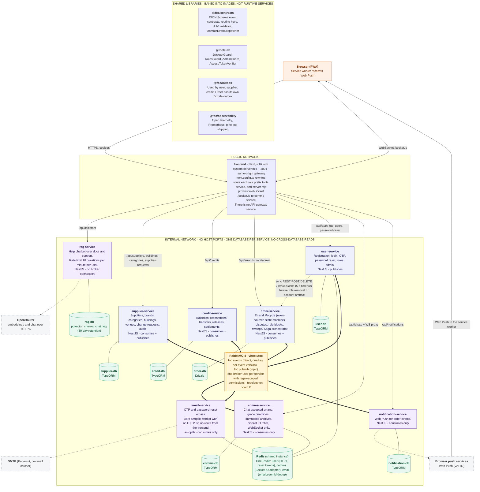

# CS3219 — Software Design and Architecture (AY2627 Sem 1)

## Friend on Campus (FoC)

**Friend on Campus (FoC)** is a peer-to-peer campus errand platform where
students can request items to be collected from stores or facilities on campus,
and other students can fulfil (and deliver) those requests. The platform runs on
a closed credit economy — credits cannot be bought, withdrawn, or exchanged for
money, and only circulate within the platform.

---

## Team Members

| Name      | Role                                                                                     |
| --------- | ---------------------------------------------------------------------------------------- |
| Arjun     | Implemented User Service, Email Service, and Notification Service. Set up Observability. |
| Anthony   | Implemented Supplier Service, and the RAG Chatbot Service.                               |
| Zhen Ting | Implemented Order Service, as well as Order Service Enhancements                         |
| Jiong Rui | Implemented Order Service, and did Cloud Deployment.                                     |
| Thaddaeus | Implemented Credit Service and Real Time Chat.                                           |

---

## Repository Structure

This repository follows a **one-service-per-folder** structure: each
microservice (`user-service/`, `supplier-service/`, `order-service/`,
`credit-service/`, `comms-service/`) lives in its own top-level folder.

```text
.
├── user-service/
├── supplier-service/
├── order-service/
├── credit-service/
├── comms-service/
├── email-service/
├── notification-service/
├── rag-service/
├── frontend/
└── README.md
```

- Any **nice-to-have (N2H)** feature that warrants its own service should be
  added as an **additional folder** at the same level, following the same
  per-service structure.
- Files for agentic coding tools (e.g. agent configs, prompts, skills) may be
  added as needed, but must still **respect the one-service-per-folder
  skeleton** for core implementation.

## Architectural diagram


### Shared Packages

Shared packages that are built in-house are stored in the `packages/` directory.
There are 4 packages:

- Auth
- Contracts
- Observability
- Outbox

### Tooling Configuration

FoC additionally runs several tools that require configuration.

- Grafana, Loki, Tempo, Prometheus have general configurations in the root
  `observability/` directory.
- RabbitMQ has its configuration and definitions stored in the root `rabbitmq/`
  directory.
- Infrastructure-related configurations live in `infra/`. Terraform and nginx
  configs are present.

### Documentation

Documentation lives in `docs/`.

- We maintain an ADR record that documents key design decisions when required.
  They are numbered and are per-service - these are stored in `docs/adr/`
- Support documentation, including a basic user guide, is in `docs/support/`

---

## Developer Guide

You are strongly recommended to use Docker with Compose to work on FoC. Node is
needed on the main development environment to run service tests and tooling
outside of Docker.

### First-time set-up

#### 1. Env Files

One `shared.env` plus one `<service>.env` per service in
`env/` (see `env/README.md`):

```sh
for f in env/*.env.example; do cp "$f" "${f%.example}"; done
```

This creates configuration for a basic development environment.


#### 2. Secrets

Each service keeps git-ignored `*.secret` files in its own
`secrets/` folder (DB password, RabbitMQ password, and for `user-service` the
JWT keypair and server secret). Where a `*.secret.example` exists, copy it
and replace the value; otherwise create the file named in the service's
`compose.yml`.

#### 3. RabbitMQ Passwords

Each service's RabbitMQ password must match its hash
in `rabbitmq/definitions.json`; see [RabbitMQ set-up](#rabbitmq-set-up).

> [!IMPORTANT]
>
>**What if I don't have the RabbitMQ passwords?**
>
> If no secrets file containing the service's RabbitMQ passwords
> (`rabbitmq_<service>_password.secret`) was provided, the definitions file will
> not match your passwords. You will need to provide your own passwords and
> update the hashes in `rabbitmq/definitions.json`.
>
> Assuming a `rabbitmq_temp` instance is running, calculate a hash with:
>
> ```bash
> docker exec rabbitmq_temp rabbitmqctl hash_password '{YOUR PASSWORD HERE}'
> ```
>
> Replace the matching service user's hash. Once the hashes in
> `definitions.json` match the corresponding
> `rabbitmq_<service>_password.secret` values, RabbitMQ setup is complete.

#### 4. Schema Migrations

**Create the Credit and Communication Service database schemas.** Neither
service migrates on startup: Credit's consumers and outbox relay fail on an
empty schema, and Communication Service's TypeORM `synchronize` is disabled
in every environment.

```sh
docker compose up -d --wait rabbitmq credit-db
docker compose build credit-service
docker compose run --rm credit-service npm run migration:run

docker compose up -d --wait rabbitmq comms-db
docker compose build comms-service
docker compose run --rm comms-service npm run migration:run
```

Order and Supplier Services apply their own migrations on startup
(`ORDER_SERVICE_DB_MIGRATIONS_RUN` / `SUPPLIER_DB_MIGRATIONS_RUN`, default
`true`). Supplier also seeds suppliers from `data/csv` on first start.

#### 5. Start the Stack

```sh
docker compose up --watch
```

`--watch` syncs source changes into the dev containers. The browser only
reaches the frontend at <http://localhost:3001>; see the next section for
direct service access.

> [!NOTE]
> The initial build **will** take a while - expect ~8 minutes.

### Debug Docker Compose Config

The debug profile provides host port mappings so that services may directly be
reached (e.g. with an API client) without using the frontend proxy.
Additionally, it allows for the `/docs` page of services that expose them to be
reached. Run the debug config with:

```sh
docker compose -f compose.yaml -f compose.debug.yaml up
```

### Day to day

| Situation                                                                   | What to run                                                                                                                                                   |
| --------------------------------------------------------------------------- | ------------------------------------------------------------------------------------------------------------------------------------------------------------- |
| Start again after a clean shutdown                                          | `docker compose up --watch`                                                                                                                                   |
| Edited source in a service                                                  | Nothing, if `--watch` is running.                                                                                                                             |
| Changed `package.json` / `package-lock.json`, a Dockerfile, or `packages/*` | `docker compose up --build --watch` (or `docker compose build <service>` first)                                                                               |
| Edited `env/*.env` or a `*.secret`                                          | `docker compose up -d --force-recreate <service>`                                                                                                             |
| Pulled a new **Credit** migration                                           | `docker compose run --rm credit-service npm run migration:run`, then restart `credit-service`                                                                 |
| Pulled a new **Communication Service** migration                            | `docker compose run --rm comms-service npm run migration:run`, then restart `comms-service`                                                                   |
| Pulled a new **Order** migration                                            | Restart `order-service`; it migrates on startup. To run it by hand: `docker compose run --rm --no-deps order-service npm run db:migrate`                      |
| Pulled a new **Supplier** migration                                         | Restart `supplier-service`; it migrates on startup                                                                                                            |
| Changed `order-service/src/db/schema.ts`                                    | `cd order-service && npm run db:generate -- --name=<slug>` and commit the SQL and `drizzle/meta`. Existing rows need a default for any new `NOT NULL` column. |
| Changed an entity in Credit or Supplier                                     | `npm run migration:generate -- src/database/migrations/<name>` in that service; `synchronize` stays off                                                       |
| Changed `rabbitmq/definitions.json`                                         | The broker only imports it on a fresh volume: `docker compose down rabbitmq && docker volume rm <project>_rabbitmq_data`, then `up`                           |
| Wipe all data and start over                                                | `docker compose down -v`, then repeat step 4                                                                                                                  |
| Run the pinned, versioned images                                            | `./scripts/build-images.sh up -d --wait` (plain `docker compose` uses the `dev` tag)                                                                          |
| Debug a service or DB directly (Swagger, psql)                              | `docker compose -f compose.yaml -f compose.debug.yaml up -d --wait`                                                                                           |

Service-specific workflows and verification commands are in each service's
README, e.g. [Credit Service](credit-service/README.md#run-with-docker-compose)
or [Communication Service](comms-service/README.md#local-commands).

## AI Declaration

Tools: Copilot, Opencode, Codex, Claude Code, Claude Design Models: GLM
(SoClaas), Big Pickle, GPT 5.6 Sol, GPT 6.1 Sol, Sonnet 5.5

All code was reviewed & approved by a separate contributor than the implementer.

### Usage Scenarios

Used for:

- Maintaining ADRs based on human decisions
- Maintaining an AGENTS.md for repository context
- Agentic coding driven by human decisions
  - Primary pattern: Passing in human-written FRs/Issues with already-stated
    architectures and telling agent to implement
  - Unit tests
  - Debugging (pasting issues then requesting a diagnosis)
  - Refactoring
    - Driving agent by mentioning which goals the refactoring is going to
      achieve (e.g. SLAP the code, extract methods, etc.)
- Explaining code
  - Only in regards to sections not developed by the prompter.
- Code Review
  - Always in conjunction with human reviews, used as supplementary rather than
    a replacement.
- Designing frontend, with tweaks made.

### Skills

The apple-design skill was used in designing the frontend - see
`.github/skills/apple-design/SKILL.md`.

Other than that, other tool in-built skills (such as code-review) were used.
