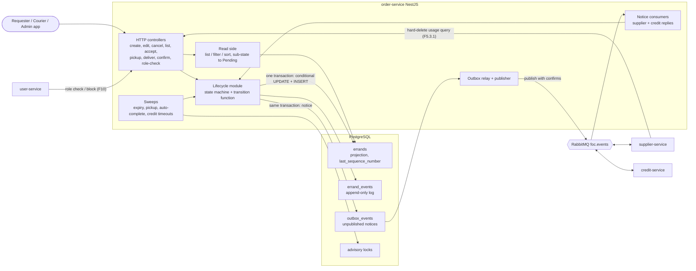
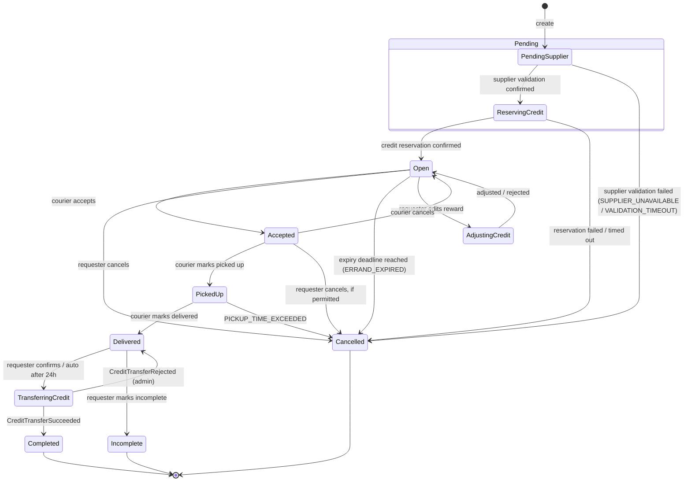
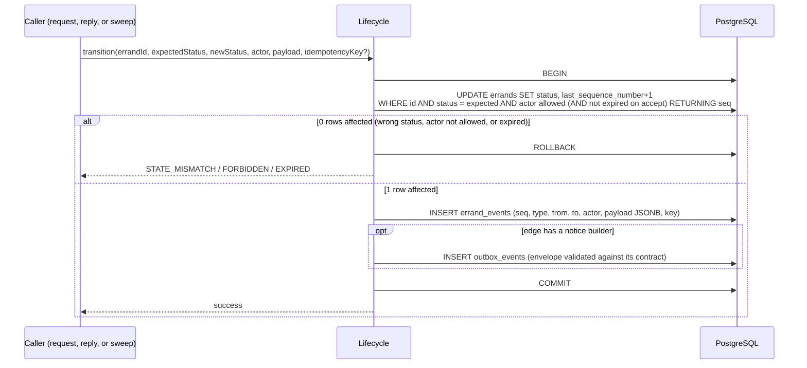
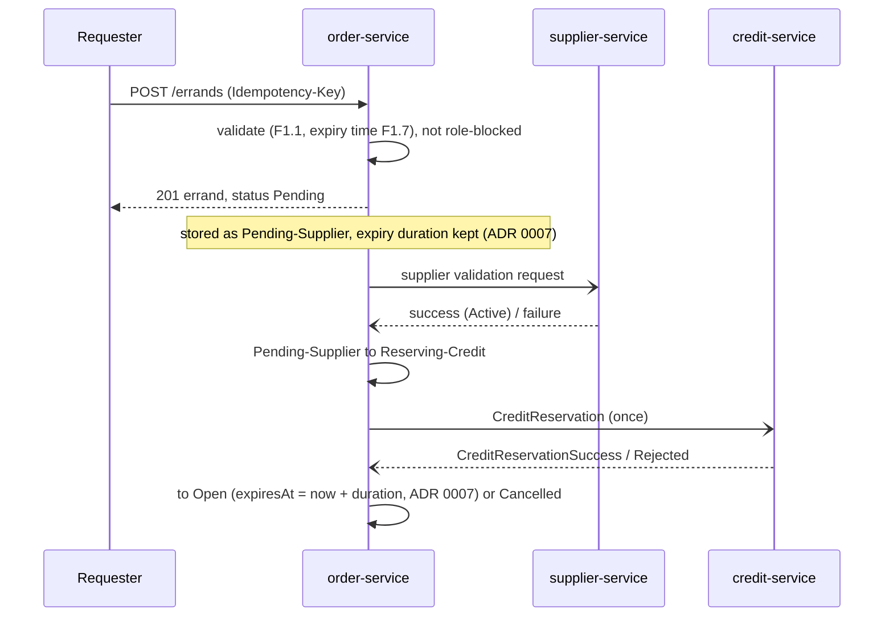

# order-service architecture

Diagrams are Mermaid (render on GitHub / VS Code). Decisions behind them: ADRs [0001](../docs/adr/order-service/0001-hand-rolled-event-sourcing-on-postgres.md)–[0007](../docs/adr/order-service/0007-expiry-duration-autocomplete-and-supplier-validation.md), [0008](../docs/adr/order-service/0008-transactional-outbox-and-broker-access.md). Terms: [`CONTEXT.md`](./CONTEXT.md).

## 1. Components

Only the Lifecycle module writes. Every write, from a request, a notice reply or a sweep, goes through the same transition function.

## 2. State model (F9.4, ADR 0006)

18 edges over 11 statuses. Terminal states: Completed, Cancelled, Incomplete. There is no Expired state. `Pending-Supplier`, `Reserving-Credit`, `Transferring-Credit` and `Adjusting-Credit` are internal; the read side shows `Pending-Supplier` / `Reserving-Credit` as `Pending`, `Transferring-Credit` as `Completed` and `Adjusting-Credit` as `Open`.
1) Pending-Supplier -> Reserving-Credit (supplier validation confirmed)
2) Pending-Supplier -> Cancelled (supplier validation failed)
3) Reserving-Credit -> Open (credit reservation confirmed)
4) Reserving-Credit -> Cancelled (credit reservation failed or timed out)
5) Open -> Accepted (courier accepts the errand)
6) Open -> Cancelled (requester cancels before acceptance, or ERRAND_EXPIRED when the expiry time is reached)
7) Open -> Adjusting-Credit (requester edits the reward, F2)
8) Adjusting-Credit -> Open, `CreditAdjusted` (adjustment confirmed, new `rewardCredits`)
9) Adjusting-Credit -> Open, `CreditAdjustmentFailed` (adjustment rejected, amount unchanged)
10) Accepted -> Picked Up (courier marks picked up)
11) Accepted -> Open (courier cancels after accepting, before pickup)
12) Accepted -> Cancelled (requester cancels after acceptance, before pickup, if permitted)
13) Picked Up -> Delivered (courier marks delivered)
14) Picked Up -> Cancelled (PICKUP_TIME_EXCEEDED, system only; the requester cannot cancel once picked up)
15) Delivered -> Transferring-Credit (requester confirms delivery, or auto-complete after 24h)
16) Transferring-Credit -> Completed (`CreditTransferSucceeded`)
17) Transferring-Credit -> Delivered (`CreditTransferRejected`; goes to an admin, the auto-complete sweep skips it)
18) Delivered -> Incomplete (requester marks delivery as incomplete)

18 edges over 17 distinct status pairs: the two `Adjusting-Credit` -> `Open` exits (items 8 and 9) share a pair, so a caller picks between them with `TransitionInput.type`.

### Who may take an edge, and guards

Each edge in `edges.ts` lists the actors allowed to take it (`who`); the check is part of the conditional UPDATE, so it is race-safe. The actor is a required tagged value (`{ kind: 'user', id }` or `SYSTEM`); a missing or malformed actor is `INVALID_FIELDS`, never the system. Only reply consumers and sweeps build `SYSTEM`. It is stored as a null `actor_id`.

| Edge(s) | Allowed actors |
| --- | --- |
| 1, 2, 3, 4, 8, 9, 16, 17 (supplier and credit replies, timeouts) | system |
| 5 `Open` -> `Accepted` | any user except the requester; `courierId` must be the actor |
| 6 `Open` -> `Cancelled` | requester (`REQUESTER_CANCELLED`) or system (`ERRAND_EXPIRED`); a user reason needs a user actor, every other reason the system |
| 12 `Accepted` -> `Cancelled` | requester (`REQUESTER_CANCELLED`); the courier withdraws via edge 11 instead |
| 14 `Picked Up` -> `Cancelled` | system only |
| 7 edit, 18 incomplete | requester |
| 10, 11, 13 (pick up, withdraw, deliver) | the errand's courier |
| 15 confirm | requester or system (24h auto-complete) |

Further guards: a courier may hold one active errand (`Accepted` or `Picked Up`), enforced by a partial unique index (`COURIER_BUSY`); item 5 is refused once `expires_at` has passed (`EXPIRED`), a backstop only: it rejects the accept but does not cancel, and the expiry sweep is what moves the errand `Open` → `Cancelled` (`ERRAND_EXPIRED`); a cancel's `cancellationReason` must be in that edge's subset of `CANCELLATION_REASONS` (`INVALID_FIELDS`). A refused actor gets `FORBIDDEN`.

Cancelling (requester cancel, expiry, `PICKUP_TIME_EXCEEDED`, `Accepted` cancel) is a direct edge to `Cancelled`; the release notice to credit is fire-and-forget. A reply timeout never reverts: re-send, then leave the errand in its in-flight status and alert an admin.

## 3. The write path (all transitions)

Publishing after commit would lose a notice if the process dies between commit and publish, so notices go through a transactional outbox ([ADR 0008](../docs/adr/order-service/0008-transactional-outbox-and-broker-access.md)): the notice is inserted into `outbox_events` in the same transaction as the event, and a relay (`src/outbox/`) publishes it to `foc.events` with confirms. `transition()` calls `enqueueNotice` (`src/lifecycle/notice.ts`) right after the event insert, using the `notice` builder on the edge it took; the envelope is validated against its `@foc/contracts` schema first, and a failure throws and rolls the whole transition back. A replayed transition returns early and writes nothing. `createErrand()` emits nothing yet (the supplier request has no contract). Delivery is at least once, so consumers dedupe on `eventId`.

Concurrent accepts, late credit replies and sweep ticks all lose safely at the `WHERE status = expected` check. No Redis or RabbitMQ is involved in the race.

### Idempotent requests: the `replayed` flag

A successful result carries `replayed: true` when the request was an idempotent repeat: the change already happened, so nothing new was written and no new notice is published. The first, fresh application has no `replayed` field (it is absent, never `false`). Callers must treat `replayed: true` as success and skip any follow-up they would do after a fresh write. It is set in three cases:

| Case | Where | Returned |
|---|---|---|
| Transition repeated with the same `idempotencyKey` and same fingerprint (`expected\|to\|actor\|type\|hash(set, payload)`; server-stamped timestamps excluded) | `transition.ts`, key claim | The first outcome stored in `idempotency_keys`, plus `replayed: true` |
| Transition repeated with no key: the errand's latest event is this same edge by this same actor (F9.10, #349) | `transition.ts`, after a `WHERE status = expected` miss | `{ ok: true, sequenceNumber: <the existing event's>, replayed: true }` |
| Create repeated with the same requester and `idempotencyKey` | `create.ts` | `{ ok: true, errandId: <the original errand's>, replayed: true }` |

Not flagged as replays: a repeated key whose fingerprint differs returns `IDEMPOTENCY_KEY_REUSED`, and a repeated key whose first outcome was a rejection returns that same rejection verbatim (`ok: false`), because `replayed` only exists on success. See [ADR 0005](../docs/adr/order-service/0005-errand-event-record-shape.md) for why a key keeps one outcome for its lifetime.

## 4. Create errand (the longest flow)

`createErrand()` takes `expiryDurationMinutes` (15 to 10080, default 60), kept only in the `ErrandCreated` payload; the `CreditReserved` edge sets `expires_at` and records it in its own payload (ADR 0007). Creation never blocks on the supplier or credit outcome (F1.4.2). If Supplier Service is unreachable the errand stays in `Pending-Supplier`; the supplier retry sweep is not built yet (no supplier contract).

## Remaining work before rollout

Not needed to merge the lifecycle/sweeps work; needed before it is relied on:

- **Cleanup (item 5):** per-type payload validation (L3, ADR 0005), the health route, the ADR 0002 amendment, the §2 diagram check, and the backlog issue edits.
- **Verification (item 6):** a real-broker `test:messaging` case (at least that a sweep re-queued event id is re-delivered), a fixture script faking credit's replies, and the rollout-order check (credit's queues must be bound before order publishes; a direct exchange drops unbound messages silently).
- **Not built:** the `Pending-Supplier` retry and hold-window sweep (no supplier contract); `supplier_validated_at` (ADR 0007).
