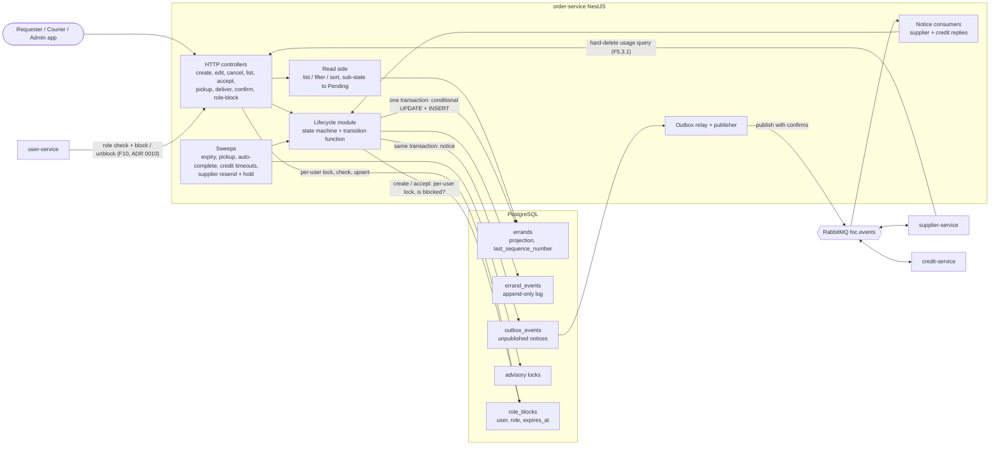
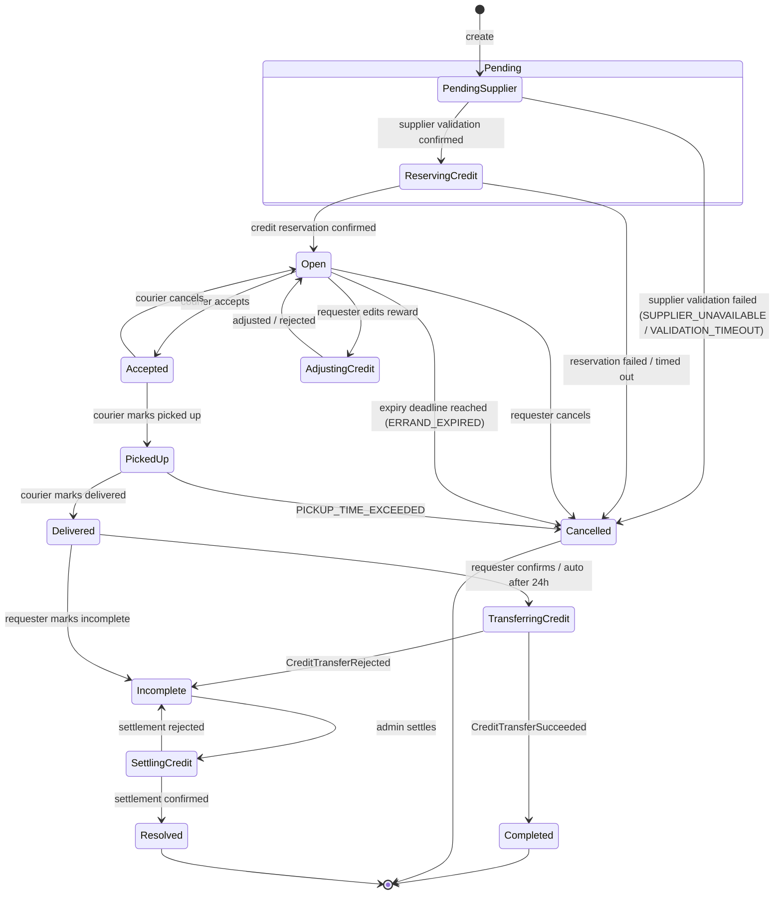
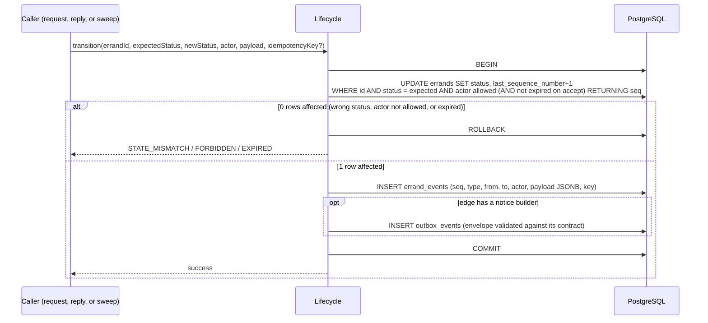
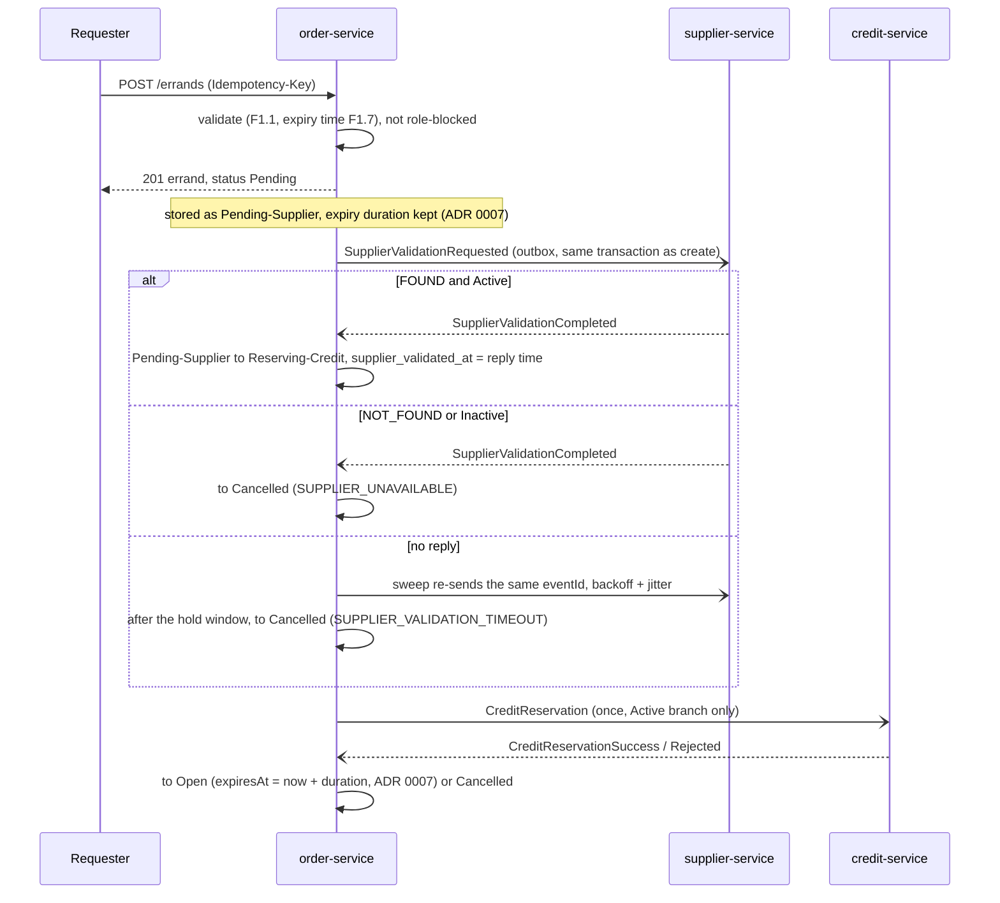

# order-service architecture

Diagrams are Mermaid (render on GitHub / VS Code). Decisions behind them: ADRs [0001](../docs/adr/order-service/0001-hand-rolled-event-sourcing-on-postgres.md)–[0007](../docs/adr/order-service/0007-expiry-duration-autocomplete-and-supplier-validation.md), [0008](../docs/adr/order-service/0008-transactional-outbox-and-broker-access.md), [0009](../docs/adr/order-service/0009-referenced-data-ids-and-supplier-snapshot.md), [0010](../docs/adr/order-service/0010-role-block-with-ttl.md). Terms: [`CONTEXT.md`](./CONTEXT.md).

## 1. Components

Only the Lifecycle module writes errands. Every write, from a request, a notice reply or a sweep, goes through the same transition function.

Role blocks (F10, [ADR 0010](../docs/adr/order-service/0010-role-block-with-ttl.md)): user-service calls `POST v1/role-blocks` before removing a role or archiving a user. In one transaction order-service checks the user has no ongoing errands for each named role (requester: any non-terminal errand; courier: `Accepted` or `Picked Up`) and upserts a `role_blocks` row per role that expires after `ROLE_BLOCK_TTL_MS`. Any role in use: `409 ROLE_IN_USE`, nothing blocked. `DELETE v1/role-blocks` removes blocks early. While a block is live, create (requester) and accept (courier) refuse with `403 ROLE_BLOCKED`, so a stale access token cannot start new work. Block, unblock, create and accept each take a per-user `pg_advisory_xact_lock` first, so a block and a concurrent create or accept never both succeed. The block service writes only `role_blocks`.

## 2. State model (F9.4, ADR 0006)

20 edges over 13 statuses. Terminal states: Completed, Cancelled, Resolved (`Incomplete` is not terminal: an admin can settle it). There is no Expired state. `Pending-Supplier`, `Reserving-Credit`, `Transferring-Credit`, `Adjusting-Credit` and `Settling-Credit` are internal; the read side shows `Pending-Supplier` / `Reserving-Credit` as `Pending`, `Transferring-Credit` as `Completed`, `Adjusting-Credit` as `Open` and `Settling-Credit` as `Incomplete`. `Resolved` is its own client-facing status.
1) Pending-Supplier -> Reserving-Credit (supplier validation confirmed)
2) Pending-Supplier -> Cancelled (supplier validation failed)
3) Reserving-Credit -> Open (credit reservation confirmed)
4) Reserving-Credit -> Cancelled (credit reservation failed or timed out)
5) Open -> Accepted (courier accepts the errand)
6) Open -> Cancelled (requester cancels before acceptance, or ERRAND_EXPIRED when the expiry time is reached)
7) Open -> Adjusting-Credit (requester edits the reward, F2)
8) Adjusting-Credit -> Open, `CreditAdjusted` (adjustment confirmed, new `rewardCredits`)
9) Adjusting-Credit -> Open, `CreditAdjustmentFailed` (adjustment rejected, amount unchanged)
10) Accepted -> Picked Up (courier marks picked up)
11) Accepted -> Open (courier cancels after accepting, before pickup; must give a reason, F7.4)
12) Picked Up -> Delivered (courier marks delivered)
13) Picked Up -> Cancelled (PICKUP_TIME_EXCEEDED, system only; the requester cannot cancel once picked up)
14) Delivered -> Transferring-Credit (requester confirms delivery, or auto-complete after 24h)
15) Transferring-Credit -> Completed (`CreditTransferSucceeded`)
16) Transferring-Credit -> Incomplete (`CreditTransferRejected`; credit's rejection is terminal, so the errand waits there for dispute handling, which an admin settles through edge 18; the reserved credits stay held until then)
17) Delivered -> Incomplete (requester marks delivery as incomplete)
18) Incomplete -> Settling-Credit (admin settles the dispute: courier's share of the reward, 0 to `rewardCredits`)
19) Settling-Credit -> Resolved (credit confirmed the settlement)
20) Settling-Credit -> Incomplete (credit rejected the settlement; the admin may retry)

20 edges over 19 distinct status pairs: the two `Adjusting-Credit` -> `Open` exits (items 8 and 9) share a pair, so a caller picks between them with `TransitionInput.type`.

### Who may take an edge, and guards

Each edge in `edges.ts` lists the actors allowed to take it (`who`); the check is part of the conditional UPDATE, so it is race-safe. The actor is a required tagged value (`{ kind: 'user', id }` or `SYSTEM`); a missing or malformed actor is `INVALID_FIELDS`, never the system. Only reply consumers and sweeps build `SYSTEM`. It is stored as a null `actor_id`.

| Edge(s) | Allowed actors |
| --- | --- |
| 1, 2, 3, 4, 8, 9, 15, 16 (supplier and credit replies, timeouts) | system |
| 5 `Open` -> `Accepted` | any user except the requester; `courierId` must be the actor |
| 6 `Open` -> `Cancelled` | requester (`REQUESTER_CANCELLED`) or system (`ERRAND_EXPIRED`); a user reason needs a user actor, every other reason the system |
| 13 `Picked Up` -> `Cancelled` | system only |
| 7 edit, 17 incomplete | requester |
| 10, 11, 12 (pick up, withdraw, deliver) | the errand's courier |
| 14 confirm | requester or system (24h auto-complete) |

There is no `Accepted` -> `Cancelled` edge: the requester cannot cancel once accepted; the courier withdraws via edge 11 instead.

Further guards: a courier may hold one active errand (`Accepted` or `Picked Up`), enforced by a partial unique index (`COURIER_BUSY`); item 5 is refused once `expires_at` has passed (`EXPIRED`), a backstop only: it rejects the accept but does not cancel, and the expiry sweep is what moves the errand `Open` → `Cancelled` (`ERRAND_EXPIRED`); a courier with a live role block cannot accept (`ROLE_BLOCKED`, as create refuses a blocked requester); a cancel's `cancellationReason` must be in that edge's subset of `CANCELLATION_REASONS` (`INVALID_FIELDS`). A refused actor gets `FORBIDDEN`.
20 edges over 13 statuses. Terminal states: Completed, Cancelled, Resolved (`Incomplete` is not terminal: an admin can settle it). There is no Expired state: expiry is a cancel with reason `ERRAND_EXPIRED`. `Pending-Supplier`, `Reserving-Credit`, `Transferring-Credit`, `Adjusting-Credit` and `Settling-Credit` are internal; the read side shows `Pending-Supplier` / `Reserving-Credit` as `Pending`, `Transferring-Credit` as `Completed`, `Adjusting-Credit` as `Open` and `Settling-Credit` as `Incomplete`. `Resolved` is its own client-facing status.

Each row is one database transaction (§3): a conditional `UPDATE … WHERE status = <from> AND <actor check>`, the event insert and, if the edge has one, the outbox notice. Either all three commit or none do. "Credit op" is the notice order-service sends; credit-service owns the balances.

| # | From → To | Event | Triggered by | Conditions | Credit op → resulting state |
|---|---|---|---|---|---|
| 1 | Pending-Supplier → Reserving-Credit | `SupplierValidated` | system: supplier reply `FOUND` + `Active` | supplier exists and is Active | `credit.reservation.v1` (hold `rewardCredits`); waits in Reserving-Credit |
| 2 | Pending-Supplier → Cancelled | `ErrandCancelled` | system: supplier reply `NOT_FOUND` / `Inactive` (`SUPPLIER_UNAVAILABLE`), or hold-window sweep (`SUPPLIER_VALIDATION_TIMEOUT`) | reason fits the edge | none: nothing reserved yet |
| 3 | Reserving-Credit → Open | `CreditReserved` | system: `credit.reservation-success.v1` | — | credits held; sets `expires_at` = now + duration (ADR 0007) |
| 4 | Reserving-Credit → Cancelled | `ErrandCancelled` | system: `credit.reservation-rejected.v1` (`INSUFFICIENT_CREDITS`, `MISSING_BALANCE`), or sweep after `RESERVING_CREDIT_TIMEOUT_MS` (`CREDIT_TIMEOUT`) | reason fits the edge | rejection: none. Timeout: `order.errand-cancelled.v1` (release, in case a reservation landed) |
| 5 | Open → Accepted | `ErrandAccepted` | courier: `POST /:id/accept` | caller is not the requester; `expires_at` not passed; caller holds no other `Accepted` / `Picked Up` errand | none; credits stay held |
| 6 | Open → Cancelled | `ErrandCancelled` | requester: `POST /:id/cancel` (`REQUESTER_CANCELLED`), or expiry sweep (`ERRAND_EXPIRED`) | user reason needs the requester, system reason the system | `order.errand-cancelled.v1`: release back to the requester |
| 7 | Open → Adjusting-Credit | `AdjustmentRequested` | requester: `POST /:id/adjust` | `newAmount` a positive integer | `credit.reservation-adjustment.v1` (old → new amount) |
| 8 | Adjusting-Credit → Open | `CreditAdjusted` | system: `credit.reservation-adjustment-success.v1` | — | `rewardCredits` = new amount |
| 9 | Adjusting-Credit → Open | `CreditAdjustmentFailed` | system: `credit.reservation-adjustment-rejected.v1` | — | amount unchanged |
| 10 | Accepted → Picked Up | `ErrandPickedUp` | assigned courier: `POST /:id/pickup` | — | none; starts the 24h pickup timer |
| 11 | Accepted → Open | `CourierWithdrew` | assigned courier: `POST /:id/withdraw` | non-blank `reason` (F7.4) | none; clears `courierId`, credits stay held |
| 12 | Picked Up → Delivered | `ErrandDelivered` | assigned courier: `POST /:id/deliver` | — | none; starts the 24h auto-complete timer |
| 13 | Picked Up → Cancelled | `ErrandCancelled` | system: sweep 24h after pickup (`PICKUP_TIME_EXCEEDED`) | — | `order.errand-cancelled.v1`: release |
| 14 | Delivered → Transferring-Credit | `ErrandConfirmed` | requester: `POST /:id/confirm`, or sweep 24h after delivery | — | `order.errand-completed.v1`: transfer the held credits to the courier |
| 15 | Transferring-Credit → Completed | `CreditTransferSucceeded` | system: `credit.transfer-succeeded.v1` | — | credits now in the courier's balance |
| 16 | Transferring-Credit → Incomplete | `CreditTransferRejected` | system: `credit.transfer-rejected.v1` | — | none; the reservation stays held for dispute handling (edge 18) |
| 17 | Delivered → Incomplete | `ErrandIncomplete` | requester: `POST /:id/incomplete` | — | none; the reservation stays held for dispute handling (edge 18) |
| 18 | Incomplete → Settling-Credit | `SettlementRequested` | admin: resolve | `0 <= settlementAmount <= rewardCredits`, non-blank note | `credit.settlement.v1`: courier gets the amount, requester the rest |
| 19 | Settling-Credit → Resolved | `CreditSettlementSucceeded` | system: credit's settlement success reply | — | credits moved per the settlement |
| 20 | Settling-Credit → Incomplete | `CreditSettlementRejected` | system: credit's settlement rejection reply | — | none; settlement columns cleared, the admin may retry |

Edges 8 and 9 share a status pair, so a caller picks between them with `TransitionInput.type`. There is no `Accepted` → `Cancelled` edge: the requester cannot cancel once accepted; the courier withdraws (11) instead. Accept (5) refusing an expired errand is a backstop only: the expiry sweep is what cancels it.

The actor is a required tagged value (`{ kind: 'user', id }` or `SYSTEM`), stored as `actor_id` (null for the system). Only reply consumers and sweeps build `SYSTEM`; a missing or malformed actor is `INVALID_FIELDS`, never the system.

### How invalid requests are rejected

The guards and validation run first, then `transition()`; the first check that fails decides the answer.

| Check | Code | HTTP |
|---|---|---|
| No valid access token | — | 401 |
| Token lacks the route's participant role (`@Roles`), or `isAdmin` on admin routes | — | 403 |
| Bad path id, body, or `Idempotency-Key` header | `INVALID_FIELDS` / `INVALID_IDEMPOTENCY_KEY` | 400 |
| Key already used for a different request | `IDEMPOTENCY_KEY_REUSED` | 422 |
| Same request again (same key, or no key and the latest event is this edge by this caller) | — | 200, `Idempotent-Replayed: true`, nothing written |
| Errand does not exist | `NOT_FOUND` | 404 |
| Cancel outside `Open` | `NOT_CANCELLABLE` | 409 |
| Errand in the edge's from-status, but the caller is not allowed by `who` | `FORBIDDEN` | 403 |
| Accept after `expires_at` | `EXPIRED` | 409 |
| Accepting courier already holds an active errand (partial unique index) | `COURIER_BUSY` | 409 |
| Errand no longer in the edge's from-status (someone else moved it first) | `STATE_MISMATCH`; a lost accept is `ERRAND_UNAVAILABLE` | 409 |

`ILLEGAL_TRANSITION` (no edge between the two statuses) cannot come from HTTP, since every route names a real edge; it guards internal callers.

### Authorization: identity, role, relationship

Three layers, all on the backend; hiding a button in the UI is never the check.

1. **Identity.** `JwtAuthGuard` (`@foc/auth`) verifies user-service's RS256 access token (cookie, else `Bearer`). The caller is the token's `sub`. Ids never come from the body: create stores `sub` as `requesterId`, and accept stores `sub` as `courierId` (any other value is `INVALID_FIELDS`).
2. **Role.** `RolesGuard` + `@Roles` is a coarse gate: courier routes need the `courier` role in the token, requester routes `requester`. Admin is the token's `isAdmin` flag, checked by `AdminGuard`; admin routes are read-only.
3. **Relationship.** Each edge's `who` is part of the conditional `UPDATE`, so it is checked against the row in the same statement that changes it (race-safe):

| `who` | Means | SQL condition |
|---|---|---|
| `requester` | the errand's requester | `requester_id = caller` |
| `courier` | the errand's assigned courier | `courier_id = caller` |
| `other` | anyone but the requester (accept only) | `requester_id <> caller` |
| `system` | a reply consumer or sweep | caller is `SYSTEM` |

So a requester accepting their own errand gets `403 FORBIDDEN`, and so does an unrelated user marking someone else's errand delivered. If the errand is not in that edge's from-status, the status check fails first and the answer is `409 STATE_MISMATCH`. Reads follow the same rule: the open list leaves out the caller's own errands, and detail shows a non-`Open` errand only to its two parties (404 for anyone else).

**One student, both roles.** A token may carry both roles. The role decides which routes the caller may use, and the relationship to each errand decides what they may do to it. So one student can have errands open as a requester while couriering someone else's, but can never courier their own (`other`), and can hold only one active courier errand at a time (`COURIER_BUSY`). Locking a role while it has ongoing errands (F10) is not built yet.

Cancelling (requester cancel, expiry, `PICKUP_TIME_EXCEEDED`) is a direct edge to `Cancelled`; the release notice to credit is fire-and-forget. A reply timeout never reverts: re-send, then leave the errand in its in-flight status and alert an admin.

## 3. The write path (all transitions)

Publishing after commit would lose a notice if the process dies between commit and publish, so notices go through a transactional outbox ([ADR 0008](../docs/adr/order-service/0008-transactional-outbox-and-broker-access.md)): the notice is inserted into `outbox_events` in the same transaction as the event, and a relay (`src/outbox/`) publishes it to `foc.events` with confirms. `transition()` calls `enqueueNotice` (`src/lifecycle/notice.ts`) right after the event insert, using the `notice` builder on the edge it took; the envelope is validated against its `@foc/contracts` schema first, and a failure throws and rolls the whole transition back. A replayed transition returns early and writes nothing. `createErrand()` writes the supplier validation request (`order.supplier-validation-requested.v1`) the same way, in the transaction that inserts the errand. Delivery is at least once, so consumers dedupe on `eventId`.

Concurrent accepts, late credit replies and sweep ticks all lose safely at the `WHERE status = expected` check. The losing accept gets `409 ERRAND_UNAVAILABLE` ("no longer available", F5.3.2); the client should refresh its listing. No Redis or RabbitMQ is involved in the race.

### Idempotent requests: the `replayed` flag

A successful result carries `replayed: true` when the request was an idempotent repeat: the change already happened, so nothing new was written and no new notice is published. The first, fresh application has no `replayed` field (it is absent, never `false`). Callers must treat `replayed: true` as success and skip any follow-up they would do after a fresh write. It is set in three cases:

| Case | Where | Returned |
|---|---|---|
| Transition repeated with the same `idempotencyKey` and same fingerprint (`expected\|to\|actor\|type\|hash(set, payload)`; server-stamped timestamps excluded) | `transition.ts`, key claim | The first outcome stored in `idempotency_keys`, plus `replayed: true` |
| Transition repeated with no key: the errand's latest event is this same edge by this same actor (F9.10, #349) | `transition.ts`, after a `WHERE status = expected` miss | `{ ok: true, sequenceNumber: <the existing event's>, replayed: true }` |
| Create repeated with the same requester, `idempotencyKey` and request (compared with the `ErrandCreated` payload, not the row, which may have changed since) | `create.ts` | `{ ok: true, errandId: <the original errand's>, replayed: true }` |

Not flagged as replays: a repeated key whose fingerprint (or, for create, request) differs returns `IDEMPOTENCY_KEY_REUSED`, and a repeated key whose first outcome was a rejection returns that same rejection verbatim (`ok: false`), because `replayed` only exists on success. See [ADR 0005](../docs/adr/order-service/0005-errand-event-record-shape.md) for why a key keeps one outcome for its lifetime.

## 4. Create errand (the longest flow)

`createErrand()` requires `expiryDurationMinutes` (15 to 10080) and a non-blank `collectionItems` string. The duration stays in the `ErrandCreated` payload only; `collectionItems` is also an `errands` column (read-only, not filtered); the `CreditReserved` edge sets `expires_at` and records it in its own payload (ADR 0007). Creation never blocks on the supplier or credit outcome (F1.4.2).

Supplier validation (`src/supplier-replies/`, supplier ADR 0002): an Active supplier moves the errand on, sets `pickup_name` (supplier display name), `pickup_location` (building short name) and `pickup_description` (floor and spot) from the reply's supplier snapshot (ADR 0009), and the `SupplierValidated` event keeps that snapshot verbatim; a missing or Inactive one cancels it (F1.4.4); nothing is reserved yet, so no release is sent. A reply whose `supplierId` is not the errand's is dead-lettered, and the errand stays in `Pending-Supplier`. If no reply comes (F1.5), a sweep sends a new request with its own `eventId` (derived from the errand and attempt number). Supplier Service answers each `eventId` only once, so reusing the original would never recover a lost reply. Extra replies hit the `Pending-Supplier` guard and are acked. The sweep skips a resend while the relay has not yet published the previous request, and uses exponential backoff and jitter (`SUPPLIER_RETRY_BASE_MS`, `SUPPLIER_RETRY_MAX_MS`), tracking attempts in `supplier_validation_retries`. After `SUPPLIER_VALIDATION_HOLD_MS` from creation it cancels with `SUPPLIER_VALIDATION_TIMEOUT`; a reply arriving after that is acked and dropped.

## 5. Read side

`ErrandsQueryService` (`src/errands/errands.query.ts`) owns every errand SELECT. It never writes and never calls `transition()`. One table (`api-status.ts`) feeds both the response `status` and the `status` filter, so sub-states are never exposed to participants (only the admin route adds them, as `internalStatus`); an internal name in a filter is a 400.

| Route | Who | Returns |
|---|---|---|
| `GET /v1/errands` | Courier | `Open` / `Adjusting-Credit` errands with `expires_at > now()`, minus the caller's own. Filters `pickupBuilding`, `deliveryBuilding`, `minCredits`; `sort=expiring\|newest\|credits` (default `expiring`, `id` tie-break) |
| `GET /v1/errands/mine` | Requester or Courier | Errands where the caller is requester or courier, newest first. Optional `role=requester\|courier` keeps one side; optional `status` (API name) |
| `GET /v1/errands/:id` | Requester or Courier | The requester and assigned courier see it in any status; anyone else only while it is `Open` and unexpired, else 404. A party still sees an expired errand, with `expiresAt` (the sweep, not the read, cancels). `requesterId`, `courierId` and `cancellationReason` appear only for the two parties |
| `GET /v1/admin/users/:userId/errands` | Admin (`AdminGuard`, the token's `isAdmin`) | The same list as `mine` for any user, same `role` / `status` / paging. Each item also carries `internalStatus` (the sub-state, labelled internal per F9.3.3), the party ids, `cancellationReason`, `pickedUpAt`, `deliveredAt` and `updatedAt` (`toAdminView`) |

Dispute routes (`/v1/admin/disputes`, admin only) read through `disputeQueue` / `disputeDetail` (explicit allowlists, one `REPEATABLE READ` snapshot for the detail) and are listed in the README. Party visibility: `toView` adds `settlementAmount` and `settlementNote` for the two parties (and, through `toAdminView`, admins) only while the errand is `Resolved`; `Settling-Credit` and a rejected `Incomplete` carry none (a rejection clears the columns).

Lists page with `limit` (default 20, max 50) and `offset`, and answer `{ items, limit, offset }` with no total. `mine` is declared before `:id` in the controller. The response is an allowlist (`toView`): never `idempotencyKey` or `lastSequenceNumber`.

## 6. Failures across services

Order-service and credit-service never share a transaction. Order changes its own row and writes the notice to the outbox in one transaction. Credit acts on the notice and replies. Every gap between those steps is either impossible by construction, or is noticed and resolved as below.

| Failure | How it is detected | How it is resolved |
|---|---|---|
| Credits reserved but errand creation fails | Cannot happen: the reservation is only requested by edge 1's notice, written in the same transaction as the errand's move | — |
| Errand saved but its notice not published (broker down, process crash) | The outbox row stays unpublished; a warning is logged after `OUTBOX_UNPUBLISHED_WARNING_MS` | The relay retries with backoff until the broker confirms. The `eventId` is stable, so credit deduplicates a double publish |
| Credit-service down or slow while reserving | Errand stays in `Reserving-Credit` | The request waits in its durable queue. After `RESERVING_CREDIT_TIMEOUT_MS` the sweep cancels with `CREDIT_TIMEOUT` and sends a release. A reservation that lands later is released again (a late success on a cancelled errand triggers another release) |
| Errand completed but credit transfer unavailable | Errand stays in `Transferring-Credit` (shown as `Completed`) past `CREDIT_REPLY_TIMEOUT_MS` | The sweep re-sends the same outbox row (same `eventId`) once per window, up to `CREDIT_RESEND_MAX` times, then logs `ADMIN ALERT` every tick. It never reverts: credit may still apply it. Reward adjustments (`Adjusting-Credit`) are handled the same way |
| A reply is lost | Same as the row above for the errand's in-flight status | Same re-send; credit answers a repeated `eventId` with its original outcome |
| The same reply is delivered twice | The reply's `eventId` is the transition's idempotency key | Replayed: nothing new is written or published |
| A reply arrives after the errand moved on | `STATE_MISMATCH` | Acked and logged as stale |
| Malformed reply, `IDEMPOTENCY_KEY_REUSED`, or a supplier reply for another supplier | Contract check fails, the key's fingerprint differs, or `supplierId` is not the errand's | Dead-lettered to the queue's `.dlq` for inspection |
| Handler throws (DB down, bug) | Exception | Retry queues at 1/2/4/8/16 s, then dead-lettered |
| Reservation rejected with `RESERVATION_CONFLICT` | Rejection reason | Dead-lettered. The errand stays in `Reserving-Credit`, and the timeout row above cancels it and releases |
| Credit rejects a release | `credit.release-rejected.v1` | Logged as an error only: the errand is already `Cancelled` |
| Credit rejects a transfer (e.g. `DESTINATION_ARCHIVED`) | `credit.transfer-rejected.v1` | Edge 16 to `Incomplete`. The credits stay held (see "Planned" below) |
| Supplier-service down during validation | Errand stays in `Pending-Supplier` | Re-sent with backoff by the sweep, then cancelled with `SUPPLIER_VALIDATION_TIMEOUT` after the hold window. A late reply is dropped. Nothing is reserved yet, so nothing is released |
| Order DB down | `/health` answers 503; requests fail | Nothing is lost: writes and notices share that DB, so neither happened |

**Ordering.** Global message order is not needed:
- An errand has at most one request to credit outstanding, because in-flight statuses accept nothing but their own reply or timeout.
- Each reply names the status it expects, so one arriving out of order is stale (`STATE_MISMATCH`) and does no harm.
- The one overlap is a timeout release racing its reservation. Credit holds a release that arrives before its reservation and retries it (credit ADR 0008).

**Planned, not built.** These are documented gaps, not current behaviour:
- **Credits held in `Incomplete` (S3, #584).** Releasing or transferring them is a dispute decision: an admin settles through the dispute routes (edge 18). Credit-service's settlement handling (#661) is not built yet, and there is no aging alert for a stale dispute.
- **Telling the user a credit step failed (S6).** The reason is already in the revert event's payload. A notice will be added on those edges once notification-service defines its event contract.
- **"You may resubmit" after `SUPPLIER_VALIDATION_TIMEOUT` (F1.5.3).** Today the requester sees `Cancelled` and the reason on the detail endpoint.
- **The `ADMIN ALERT` repeats every tick.** Windows are counted from `updated_at`, with no stored attempt count.

## Remaining work before rollout

Not needed to merge the lifecycle/sweeps work; needed before it is relied on:

- **Cleanup (item 5):** the §2 diagram check and the backlog issue edits.
- **Verification (item 6):** a real-broker `test:messaging` case (at least that a sweep re-queued event id is re-delivered), a fixture script faking credit's replies, and the rollout-order check (credit's queues must be bound before order publishes; a direct exchange drops unbound messages silently).
- **Known gap (list filters):** an empty `pickupBuilding=` / `deliveryBuilding=` is a 400 rather than ignored. `deliveryLocation` is still client text, so `deliveryBuilding` only matches when the client sends a building short name (the frontend does).
