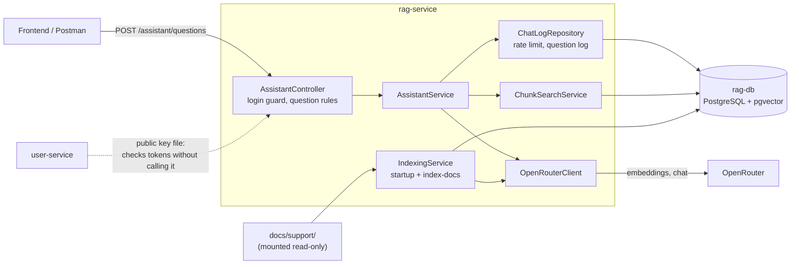
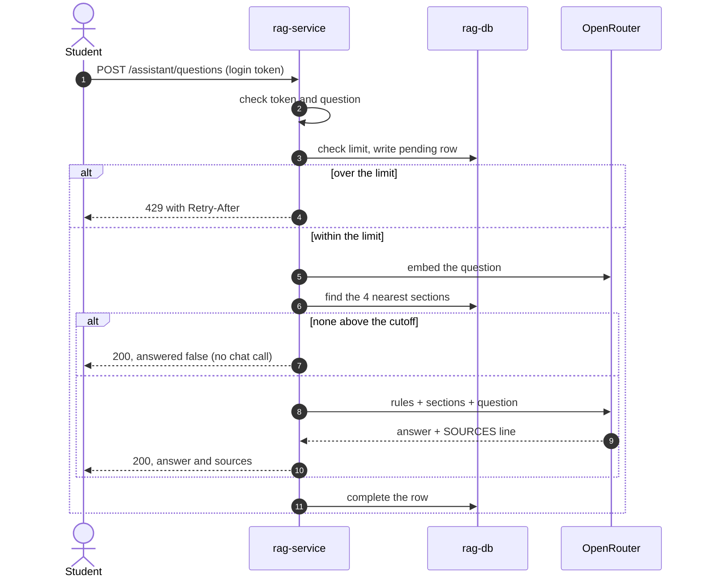

# rag-service

The FoC help chatbot. It answers general questions from the plain-language documents in `docs/support/` and names the section each answer came from. It cannot see anyone's account or change anything.

The service indexes the help documents and answers questions from them.

It's a fixed pipeline rather than an agent: our code always runs the same steps, and the model only writes the answer. Why it's built this way: [ADR 0001](../docs/adr/rag-service/0001-rag-with-pgvector-and-openrouter.md).





## First-time setup

From the repository root:

```sh
cp env/rag-service.env.example env/rag-service.env
cp rag-service/secrets/rag_db_password.secret.example rag-service/secrets/rag_db_password.secret
cp rag-service/secrets/openrouter_api_key.secret.example rag-service/secrets/openrouter_api_key.secret
```

Change the database password if you like. The placeholder OpenRouter key is enough to start the service; asking questions needs a real key. Set a spending limit on any real key in OpenRouter's dashboard.

The service also reads user-service's public key from `user-service/secrets/jwt_public_key.secret`.

## Running

`docker compose up -d --build rag-service` from the repository root. To reach it from your machine, add `-f compose.yaml -f compose.debug.yaml`: the service is on `127.0.0.1:3008` and its database on `127.0.0.1:5442`.

| Setting | Default | Meaning |
|---|---|---|
| `RAG_OPENROUTER_CHAT_MODEL` | `anthropic/claude-haiku-5.5` | The model that writes answers |
| `RAG_OPENROUTER_EMBEDDING_MODEL` | `openai/text-embedding-3-small` | The model that turns text into numbers. Changing it means re-indexing. |

The database image is [`pgvector/pgvector:pg18`](https://hub.docker.com/r/pgvector/pgvector), because the plain Postgres image has no pgvector.

## Asking a question

`POST /assistant/questions` with `{ "question": "..." }`, 1 to 500 characters. It needs a login token, like every route except `/health`.

```json
{
  "answer": "...",
  "answered": true,
  "sources": [{ "title": "Errands", "section": "Why is my errand stuck in Pending?" }]
}
```

A refusal or "can't find it" is also a 200, with `answered: false` and no sources.

| Error | When |
|---|---|
| 400 `VALIDATION_FAILED` | Bad question |
| 401 `UNAUTHENTICATED` | No valid login |
| 429 `RATE_LIMITED`, `retryAfterSeconds` and a `Retry-After` header | Over the limit |
| 503 `DEPENDENCY_UNAVAILABLE`, `retryable: true` | OpenRouter or the database is down |

How a question is answered:

1. The user's limit is checked and a `chat_log` row written, before any paid call.
2. The question is turned into numbers with the embedding model.
3. The 4 nearest sections are found. Any below `RAG_RELEVANCE_CUTOFF` are dropped.
4. If none are left, the bot says it can't find the answer, **without calling the chat model**.
5. Otherwise the chat model gets fixed rules, the sections and the question, and answers only from those sections.
6. The reply's `SOURCES` line picks which sections to show. The titles come from our database, so a source can't be invented.
7. The row is completed with the outcome, scores, timings and tokens.

The rules are in `src/assistant/prompt-builder.ts`. The bot has no tools and no access to user data, and it can't change anything, so the worst a prompt injection can do is produce an odd answer. Only the rules, sections and question reach the model, never the user's id, email or token.

Request logs have the `Authorization`, `Cookie` and `Set-Cookie` headers removed (`src/common/logging/logger-options.ts`), because they hold login tokens. Question text isn't logged.

Set a spending limit on any real key: the per-user limit doesn't stop someone using several accounts.

## Limits and the question log

Each user can ask `RAG_RATE_LIMIT_PER_MINUTE` questions (default 10) in any rolling 60 seconds. Every accepted question counts, including ones stopped by the cutoff, because each costs an embedding call. Requests refused with a 400 or 429 don't count.

`chat_log` holds one row per accepted question: the user's id, the question, the outcome, every section retrieved with its score, timings and tokens. Rows are deleted after `RAG_CHAT_LOG_RETENTION_DAYS` (default 30), at startup and once a day. The question text stays in this table and out of the application logs, which go to Loki.

| Outcome | Meaning |
|---|---|
| `pending` | Being answered, or the service stopped midway |
| `answered` | The model answered |
| `no_match` | Nothing was relevant enough, so the model wasn't called |
| `refused` | The model declined, under its rules |
| `error` | OpenRouter failed; the user got a 503 |

To find what the documents couldn't answer:

```sql
SELECT question, outcome, created_at FROM chat_log
WHERE outcome IN ('no_match', 'refused') ORDER BY created_at DESC;
```

To see the slowest answers and the tokens used per day:

```sql
SELECT question, embed_ms + search_ms + generate_ms AS total_ms FROM chat_log
WHERE outcome = 'answered' ORDER BY total_ms DESC LIMIT 10;

SELECT created_at::date AS day, sum(prompt_tokens) AS tokens_in, sum(completion_tokens) AS tokens_out
FROM chat_log GROUP BY day ORDER BY day DESC;
```

## Updating the help documents

The bot answers from an index of `docs/support/`, not from the files directly. After editing a document, do either of these:

- **Restart the service.** On startup it compares the documents with the index and re-indexes if they differ. Checking costs nothing; re-indexing every section costs a tiny fraction of a cent.
- **Re-index without a restart:** `docker compose exec rag-service npm run index-docs`

Until then the bot keeps answering from the old version. If re-indexing fails, for example because OpenRouter is down or a document breaks the format rules, the old index stays in use. Each document needs `title` and `service` in its front matter, and its `##` headings must be unique.

## Evaluation

A fixed set of questions in `eval/questions.json` measures the bot through the real API. Each answerable question lists the sections that hold its answer and the key facts it must contain; the others must be refused (account, off-topic and injection questions). It uses a real key and costs under a cent, so CI never runs it. Rerun it after changing the documents, the prompt or the cutoff.

```sh
docker compose up -d --build rag-service
docker compose exec -e EVAL_TOKEN="$(node rag-service/scripts/sign-eval-token.mjs)" rag-service npm run evaluate
```

It waits out the rate limit, so it takes a few minutes. It prints a report, including what each cutoff value would have done, and exits with an error if a target is missed.

| Measure | Target |
|---|---|
| Answer names the right section | At least 90% |
| Answer contains every key fact | At least 90% |
| Should-refuse questions refused | 100% |
| 95% of questions within | 10 seconds |

**Results:** not run yet on this version of the documents.

## Trying it with Postman

Import `api/rag-service.postman_collection.json` and `api/local.postman_environment.json`. Start the service with debug ports (`-f compose.yaml -f compose.debug.yaml`), run `node rag-service/scripts/sign-eval-token.mjs`, and paste the token into `token`. Folders 1 and 2 ask the real model, and folder 4 uses up the rate limit, so run it last or wait a minute afterwards. Answers can contain Markdown.

## Known limits

- Each question stands alone, so there are no follow-up questions.
- It gives general guidance only and can't look up anyone's account, errands or requests.
- Refusing account questions depends on the model following its rules, because they match the documents closely enough to pass the cutoff.
- Answers vary slightly between runs.
- After a document changes, the bot uses the old version until a restart or `npm run index-docs`.
- The rate limit is per account, so the spending limit on the key is the real backstop.
- The chat model's own settings can't be tuned further: its OpenRouter listing doesn't show temperature among the settings it accepts.

## Tests

Run these from `rag-service/`:

```sh
npm test                 # unit
npm run test:e2e         # the app over HTTP, database faked
npm run db:test:up && npm run test:integration && npm run db:test:down   # real pgvector database
npm run lint
```
